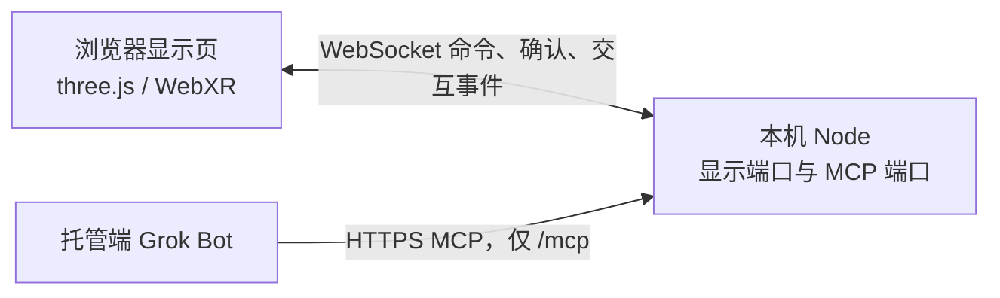

# 架构

> 待 VPS 改版更新：VPS 资源规格和部署参数尚待调研结果复核。

## 当前链路

显示页在本机浏览器中运行。托管端的 Grok Bot 通过自定义 MCP 连接器调用本服务的工具。本地调试时，快速隧道只转发 MCP 端口；显示页和 WebSocket 不进入隧道。

一个 Node 进程承载 MCP、配对、WebSocket、有界补发队列和显示页静态文件。MCP 使用单独的 localhost 端口，该端口的处理函数只识别 `/mcp`。显示页、`/ws`、配对和健康检查使用另一个 localhost 端口，并且不提供 `/mcp`。

## 下行与交互

下行：连接器调用工具 → 校验 Bearer → 写入本机队列 → WebSocket → 页面渲染 → `ack` → MCP 结果。只有页面确认序号之后，`delivered` 才是 true。等待确认的默认上限是 2 秒；超时返回 `queued` 和 `delivered=false`。

页面发往中继的 `interaction` 事件只在进程内留下记录。它不是对话入口，服务也不向模型服务发起请求。

公网 HTTPS 不代表调用已被授权。隧道端口上的每个 `/mcp` 请求都要携带正确的 Bearer 令牌。

## 进程与数据

待 VPS 改版更新：正式部署时 Caddy 只反代 MCP 端口，Node 仍只绑定 localhost。队列、幂等记录和配对会话都在内存中。进程重启后序号重新开始，页面用快照对齐，不保留对话正文。

显示页上的文字按不可信数据处理，页面用文本绘制，不解析 HTML。glTF 只接受允许列表中的 https 地址，服务端不抓取该地址。
