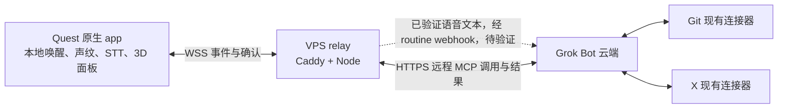

# 架构

> 待 VPS 改版更新：VPS 资源规格和部署参数尚待调研结果复核。

## 路线 M

Quest app 主动外连 VPS 的 WSS；Grok Bot 云端通过公网 HTTPS 调用 VR MCP。Caddy 终止 TLS，Node 同进程承载 MCP、设备配对、WSS 和队列。多 MCP 的选择与编排归 Grok Bot；VR 服务只负责显示和设备状态，不接管 Git、X 的授权。

## 双向链路不能混淆

下行：Bot 调用 MCP tool → 校验调用者与设备授权 → 队列 → WSS → app 渲染 → ack → MCP 结果。上行：本地双门验证 → 本地 STT → WSS utterance → Node 调用已配置的 routine webhook → Bot 调用显示工具。webhook 每次启动运行，并不天然等价于实时语音会话；不得假设 MCP 通知或 sampling 能替代对话入口。

没有 Quest 版 Grok Bot；云端无法访问只存在于头显本地的 MCP。因此必须保留公网可达服务，不能以头显本地监听器替代。公网 HTTPS 的存在也不代表任何人可调用，所有数据路由仍须鉴权。

## 进程、信任与数据

待 VPS 改版更新：一个 Node 运行宿主承载 services/vr-mcp-server 的工具逻辑和 services/relay 的传输逻辑，避免重复部署两套队列。Caddy 与 Node 同机，Node 仅监听本机回环接口；公开入口只有 Caddy。

唤醒音频、声纹模板与相似度留在头显；VPS 只接收验证通过后的文本及不含生物特征的会话标记。声纹验证并非网络鉴权，设备凭据也不能替代本地声纹门。显示文字按不可信数据处理，不能变成执行指令。

目标首包 P50 ≤1.5s、P90 ≤2.5s。按整条链路测量，不能拿 WSS 到达时间冒充 Bot 回复时间。若 webhook 无法达标，M0 判定实时语音目标未满足。
