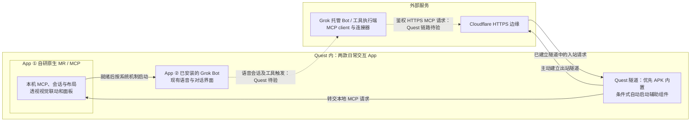

# Quest 原生 MR 空间助手方案

> 2026-11-01。方案已确认：Quest 本机 MCP、两款日常交互 App、复用 Grok Bot 语音、原生 MR 与透视视觉一体联动。隧道优先内置，条件式允许后台辅助组件。隔离适配构建先通过 ADB shell 回环，随后最小诊断 APK 通过 App UID、公网健康回环与基本生命周期验证；正式 MCP / MR、自动恢复和永久部署仍待实现。

## 产品体验与确定范围

目标是由 Grok Bot 驱动、具有钢铁侠风格的原生 Quest 透视 / MR 空间助手。用户在同一个体验中看见现实环境，唤出、摆放和管理多个空间面板；助手在许可范围内使用新鲜的视觉上下文理解现场，并把结果呈现在这些面板或三维内容上。视觉能力与透视模式统一设计、联动和验收。

**日常使用目标：打开自研 App，即可开始准备整个工作区并联动已安装的 Grok Bot App。**首次登录、权限、配对与连接器配置可能仍需用户操作；不承诺自动开麦或自动选中会话。

Quest 上日常交互围绕两款 App：

| App | 用户看到的职责 | 内部责任与边界 |
|---|---|---|
| ① 自研原生 MR / MCP App | 打开工作区，管理面板、透视视觉联动与整体连接状态，启动联动 Grok Bot | 本机 MCP、状态与布局、配对；优先由同一 APK 管理隧道，受限时评估自动启动的后台辅助组件 |
| ② 已安装的 Grok Bot App | 使用其现有 Bot、对话与语音交互 | 复用原有产品能力；不在自研 App 中自接 Grok 模型 API 重做语音或对话 |

“两款 App”指日常交互，不限制为两个操作系统进程或恰好两个 APK。优先采用自研 APK 内的 Service、受控原生子进程或库。若内置不可行但独立 cloudflared 在 Quest 实测可行，部署时可安装并配置自动启动的后台辅助组件，日常无需手动打开它；具体载体尚未选定，不默认采用 Termux / Boot。本轮不安装或配置该辅助组件。

| 已确定的需求 | 预期行为 | 尚待核实的实现条件 |
|---|---|---|
| 原生空间工作区 | 多面板独立打开、移动、缩放、更新和关闭，可结合三维对象 | 具体原生技术栈及与 Grok Bot 的共存方式 |
| 透视模式与视觉联动 | 同一 MR 体验中看现实、取得许可内的新鲜视觉上下文并呈现结果 | 原生帧访问、权限和两款 App 切换后的生命周期 |
| Quest 本机优先 | MCP 工具与状态在自研 App 内；隧道优先内置，条件式允许后台辅助组件 | Android 封装、后台约束及入口可达性；不将可行性假设写成已完成 |
| 打开一个 App 开始工作 | 自研 App 完成就绪检查后，按系统允许的机制启动 Grok Bot | 实际包身份、启动入口、登录 / 会话状态及语音工具能力 |
| 脱离 MBP 与扩展 | MBP 用于开发调试，日常服务和状态由 Quest 管理 | 长时任务与恢复能力；常在线服务端只在明确需求或实测限制下再讨论 |

已调通实现保存为检查点 `dca4f9e`，归档分支为 `archive/webxr-mvp-2026-11-01`；它仅用于追溯和回退，不是本文的新运行时路线。本方案位于 `docs/native-spatial-options-2026-11-01`。

本文区分**已确认的产品拓扑**、**平台已文档支持**、**工程候选**和**待实机验证**。服务主位置已明确为 Quest 本机。Quest 3 / Android 14 / API 34 / ARM64 上的诊断 APK 已由 App UID 执行内置 Tunnel，建立 4 条 Tunnel 连接，外部 HTTPS 200 与 App 私有回执匹配；正式本机 MCP、原生工作区、Quest 语音和后台恢复仍待实现或验收。已核对 Grok Bot 包、版本及 Launcher，未启动其会话或读取相机；测试 APK 验证后卸载，没有配置自启。详见[实机记录](03-validation-baseline.md)。

## 最早的实机与联合可行性验证

第一关的独立 Tunnel 和第二关的 APK 内置均已取得隔离健康证据。用户后续明确授权进程 DNS / CA 适配、专用具名 Tunnel / DNS、限时管理凭据、路由器 fake-IP 排除规则，并明确选择继续验证 App 内置路线。当前诊断 APK 不等于正式组件交付完成。

| 关口 | 最小验证 | 不能替代的证据 |
|---|---|---|
| A：实际执行与公网连通 | **已通过**：隔离适配构建在 Quest 执行，4 条 QUIC 连接，外部 HTTPS 返回无敏感健康响应 | 响应运行码、请求码与 Quest 本机回执一致；原始发布资产未直接通过，执行身份仍是 ADB shell |
| B：组件交付与自动恢复 | **部分通过**：APK 安装目录执行、App UID、健康回环、重复启动 / 停止 / 再启动、超时及父进程退出 | 正式凭据导入 / 轮换、更新、网络恢复、自启、休眠与长时运行仍待验 |
| C：Quest Grok Bot 语音工具调用 | 包身份、版本与 Launcher 已核对；实际语音会话经连接器触发本机 MCP 待验 | 桌面调用、启动界面或工具列表不能代替此次语音请求、工具执行与实际画面对齐 |
| D：双 App 所需体验 | 拉起 Grok Bot 后分别检查 MR 可见性、输入焦点、语音 / 音频、MCP 和视觉新帧，验证返回工作区 | Service 存活不能证明 MR 可交互或有新帧；也不能一律断言另一 App 会让 MR 消失 |

Grok Bot 官方文档确认 Android companion 共享 Bots、对话、连接器和云电脑，并提供语音入口；FAQ 区分 Grok Bot 与另一款 Grok 聊天产品。已安装包身份以设备查询为准，见实机记录。官方能力支持复用语音的方向，不能替代 Quest 上 C、D 的联合验收。来源 S29。

受阻时记录实际限制：内置限制可进入已确认的后台辅助组件候选，但安装、自启或设备永久部署仍需具体实施授权；不自行改成自接模型 API、自建语音或外部 MCP 主线。

## 原生技术栈与建议

**原生技术栈仍优先评估 Meta Spatial SDK + Compose，但先通过上述联合关口。**它更贴近同一 MR 场景内摆放多个助手面板、结合三维内容与透视的目标。技术栈必须同时满足与现有 Grok Bot 的启动、焦点和语音共存要求，不能仅凭面板示例选定。

| 原生路线 | 官方资料支持的能力 | 适用条件与限制 |
|---|---|---|
| Meta Spatial SDK + Compose | 一个空间 Activity 内动态创建多个 Android / Compose 面板及三维实体，有面板抓取、缩放和透视路径 | 优先候选；面板属于本 App，不自动成为独立系统窗口。真实房间位置的持久恢复须先验证；来源 S1–S4 |
| 普通 Android + Compose、多 Activity | 多个 Activity 可成为系统管理的独立 panel，使用系统移动和缩放控件 | 如果与其他 App 的系统窗口共存是首要需求，优先比较此路线；不承诺 App 能精确指定每个系统窗口的房间坐标；来源 S5、S6 |
| Meta VR Layout SDK | 主窗口周围组织辅助窗口，适用于非沉浸 Android App | 适合主窗口加少量工具窗口；按组移动和系统布局，不适合把每块面板任意留在不同位置；来源 S7、S8 |
| Unity + OpenXR + Meta XR SDK | 多个 Canvas / 三维对象、交互、透视与持久空间锚点有官方路径 | 复杂三维动画、物理交互或引擎资源占比较高时评估；不自动产生系统级任意多窗口；来源 S9、S10 |

Spatial SDK 可在一个空间 Activity 中动态创建多块面板。MRUK 有房间模型、场景锚点和 world-locking 支持，但本轮没有核实到可直接采用的 Kotlin 自建锚点完整跨会话保存恢复示例。保存 XYZ 布局不等于重启后回到同一真实墙面；内容恢复、相对布局恢复和真实位置恢复分别验收。来源 S1–S4。

Layout SDK 的真正空间窗口要求对应系统能力，早于 Horizon OS v207 使用回退；组合占位受 1600×960 dp 范围约束，父窗口关闭会影响辅助窗口。Compose 使用平台可用容量，React Native 当前预留两个槽位；“主窗口加两个重要辅助窗口”不能写成所有路线的统一数量上限。来源 S7、S8。实际设备的 Horizon OS 功能版本与窗口容量尚未核对；Android API 版本不等同于这些能力。

Meta 推荐 Unity OpenXR，Oculus XR 插件已弃用。来源 S9。对以助手面板为主的产品，先比较原生 UI 与空间交互的开发成本，再决定是否引入完整引擎。透明 HUD、文字清晰度、遮挡和舒适距离应在所选运行时实测，不能只用界面风格图作为验收。

系统窗口、App 内空间面板和远程电脑桌面要分别对待：后者需要额外的媒体采集、传输、解码及输入控制，窗口 SDK 不自动提供。若远程桌面的视频源来自 MBP，迁移 MCP 入口不能消除这项媒体源依赖。

## 两层拓扑与责任

以下主拓扑已获用户确认，虚线表示其中 Quest 语音会话的具体工具能力尚待实机验证。两款 App 安装在同一头显，不代表 Grok Bot 会从语音模式直接调用 localhost MCP，也不代表模型在 Quest 本机运行。

Grok Bot App 负责用户语音会话；Bot 与连接器在托管执行环境使用工具，MCP 可按 URL 或云电脑命令接入。来源 S29。工具请求的拟议路径是托管端 → Cloudflare 边缘 → Quest 隧道组件 → 本机 MCP；工具结果沿相应链路返回。`cloudflared` 只建立通道，不实现工具，流量仍经 Cloudflare 网络。来源 S11。

**现有证据边界：**已验证的是桌面 Grok Bot Apps → 托管端适配器 → HTTPS MCP → 中继 → 桌面显示及 ACK。未验证的是 Quest 已安装 App 的语音会话能否使用同一连接器，以及本机原生 MCP、MR 与视觉联动能否共同完成请求。不能把现有桌面验证迁移成 Quest 已通过；见 [历史验证记录](03-validation-baseline.md)。

| 责任归属 | 应承担的工作 |
|---|---|
| 自研 App | MCP 工具、配对与授权检查、面板 / 布局、透视视觉联动、隧道组件管理、就绪与故障状态 |
| Grok Bot App | 现有语音和对话、用户完成登录 / 选 Bot / 会话等产品操作 |
| Grok 托管端与连接器 | 执行实际工具调用、携带授权访问公开 MCP 入口；具体 Quest 会话支持待验 |
| Cloudflare 边缘与隧道 | 公网 HTTPS 接入、路由 / 转发和隧道连接；不承担模型推理或本项目工具 / 显示业务，MCP 授权仍由本机服务检查 |

本项目不增加模型 API 客户端，也不把外部 Grok Bot 界面当作可任意嵌入自研 App 的面板。视觉数据优先通过已验证支持的工具结果或媒体契约联动；若 Grok 当前会话不能消费对应内容，明确报告能力缺口。

## 打开自研 App 后的启动流程

正常重复使用以打开自研 App 为入口，首次设置与失败恢复有明确状态。以下是待实现的状态机，不代表已能自动完成 Grok 的登录、授权、Bot / 会话选择或语音开麦。

| 状态 | 自研 App 的动作与进入下一状态的条件 | 不满足时的恢复入口 |
|---|---|---|
| 1：恢复工作区 | 恢复有效会话、布局与授权状态；检查已安装 Grok Bot 的实际身份和启动入口 | 显示待完成的权限、配对或 App 检查；未知包身份先核实，不猜测替代产品 |
| 2：启动本机服务 | 启动 MCP，确认内置组件或部署时配置的后台辅助组件就绪，核对实际监听与启动结果 | 分别报告服务启动失败、连接失败或凭据失效；在本 App 内重试 / 停止 |
| 3：入口与配对检查 | 检查 HTTPS MCP 可达、调用授权及本机显示会话配对；核对连接器使用的入口 | 明确“入口未就绪”或“需要连接器配置”；仅隧道进程存在不能判定成功 |
| 4：联动 Grok Bot | 在系统允许的前台 / 用户交互条件下，发起对已安装 App 的启动 | 未安装、无启动入口或系统拒绝时给出具体状态与重试 / 手动打开入口 |
| 5：等待语音会话 | 用户进入 Grok Bot 的现有语音；需要时由用户登录、选 Bot、选会话或完成授权 | 显示尚待用户操作；App 被拉起不等于语音与工具就绪 |
| 6：联动工作中 | 语音指令经托管工具链路到本机 MCP；更新同一 MR 工作区并处理许可内视觉上下文 | 分别呈现排队、渲染完成、MR 暂停、视觉无新帧等状态，不合并为一个“已连接” |
| 7：中断与恢复 | 网络切换、进程退出或摘戴后重新检查入口、会话与有效快照；用户停止时释放资源并停止受控组件 | 不无限重启已被用户停止的任务，不重放过期指令，不反复抢占 Grok / MR 焦点 |

Android 提供目标包的启动 Intent / IntentSender 等机制，并有包可见性和后台启动限制；这些仅提供启动入口依据，不保证进入特定 Bot 或自动开麦。实际包名、版本和 Launcher 已核对，联动启动与语音仍需实测。来源 S28。

连接器首次登记或入口地址改变时可能仍需用户配置。应分别展示“本机 MCP 就绪”“公开入口已核验”“显示会话已配对”“Grok 语音工具待验证 / 已验证”，避免把本机健康检查当作远端调用已经成功。

## 本机 MCP 与 Tunnel 交付的可行性

**已确认主线：本机 MCP 工具、状态与 MR 联动由自研 App 负责；隧道优先在 APK 内管理，受限时可评估自动启动的后台辅助组件。**常在线自建 MCP 服务端不是默认推荐。同 APK 受控原生子进程已通过诊断验证；这属于本项目适配，不是 Cloudflare 官方 Android SDK。

Cloudflare 官方下载包含 Linux ARM64，但没有 Android / Horizon OS 包。维护方 Termux 提供 `cloudflared`、Go 适配及 Node 包，证明存在工程探索路线，不证明自研 APK 已可使用；Termux 只是可研究的载体之一，尚未选定，不作为正式交付前提。Node 官方也没有 Android 支持保证，现有 Node 进程不能直接当作原生 App 组件搬入。来源 S12–S14。

本轮核对了 `cloudflared` 2026.10.7 源码：入口为 Go `package main` 与命令行启动流程。本轮未核实到 Cloudflare 提供的 Android 嵌入 SDK 或稳定嵌入接口；可复用源码与可直接作为库加载是两回事。来源 S24。以下第一种已构建最小诊断组件，其他方式仍是候选：

| 封装候选 | 与两款 App 体验的关系 | 必须验证的工程条件 |
|---|---|---|
| 同一 APK 随包提供受控原生组件 / 子进程 | **最小诊断已通过**：由 App 前台 Service 管理已安装原生可执行文件 | ARM64、安装目录、App UID、健康回环和基本停止已验；正式 IPC、凭据导入 / 轮换、网络恢复与更新仍待验 |
| 封装为 Android 可调用的原生库 | 仍在同一 APK 内，通过桥接接口管理隧道生命周期 | 需适配可调用入口、Go 运行时与 JNI 等桥接、并发 / 取消 / 网络恢复；不能把 CLI 或通用 JNI 支持当成现成 Tunnel SDK |
| 条件式独立后台辅助组件 | 内置不可行而独立运行可行时，部署阶段安装并配置自动启动，日常无需另开 App | 载体选择、安装与执行身份、系统启动限制、故障恢复、更新和停止入口；本轮不安装或启用 |

Android 官方支持按 ABI 打包原生共享库及 JNI 互调，但不据此保证任意 Go 命令行程序能直接嵌入。来源 S26。针对 Android 10 / API 29+ 的限制，不能简单把可执行文件下载或解压到 App 可写目录后再执行。来源 S27。本次诊断 APK 目标 API 34，由安装器提取随包组件至 `nativeLibraryDir`，再由 App 启动；实际 UID、父进程、文件哈希和公网回执均已核对。没有使用可写目录执行、旧目标版本或系统权限修改。

`cloudflared` 主源码采用 Apache-2.0，可在满足条款的前提下修改与分发；应随分发提供许可证、保留适用声明、标识修改，并处理适用的 NOTICE。第三方依赖的许可与实际随包内容还需逐项核对。开源许可不等于 Android 技术兼容、官方平台支持或云服务使用条件已经满足。来源 S25。

自研 APK 应统一管理组件版本、启动、停止、退出原因、重连退避和更新恢复；若使用前台服务，按实际用途核对服务类型、权限、用户可见状态及系统限制。不能仅凭 Service 存活保证 MR 可见或无限保活。来源 S23、S31。内置组件的更新路径也须符合 Android 代码装载规则，不能照搬桌面自更新方式。

公网仍只暴露经授权的 MCP 入口；TLS 不替代 Bearer，显示配对与 MCP 凭据分开，凭据保留在所需的本机服务及托管连接器，不放在 URL、日志或仓库。只转发 `/mcp`，不为方便启动而公开配对、显示页或现有 `/ws`。正式凭据导入、保管、撤销和轮换是后续原生设计项；Grok 模型服务密钥无需引入自研 App。

如采用 Quick Tunnel，要处理临时地址、缺少在线保证及不支持 SSE 的限制。来源 S15。本轮外部回环采用用户授权的专用远程管理具名 Tunnel 与固定域名，管理令牌仅存开发机，Quest 只接收该 Tunnel 的连接令牌文件。验证结束保留云端资源，将入口恢复为默认拒绝并清理临时探针。后续仍需验证正式 MCP 传输、App 凭据管理及重复启动后恢复入口，不能用一次健康回环代替。

### 常在线服务端仅作条件式补充

只有实机发现本机服务无法满足明确的后台 / 休眠需求，或用户希望跨设备长期任务时，再比较常在线 MCP / 中继加 Quest 主动连接。它可以改变离线任务的承载位置，但不能自行替代用户的本机优先主线，也不能解决 Grok 语音或两款 App 共存能力缺失。

旧 VPS / Caddy / systemd 示例、容器构建文件及旧路线文档已从当前分支清理，历史可由 Git 追溯，其他常在线主机或 LXC 未选定。本轮不迁移运行服务，不重新采用历史否决的 Worker 方案。没有端到端样本，不宣称本机路线必然延迟更低。

## 透视模式与视觉联动

产品流程是一体的：用户进入原生 MR 工作区，看见现实与助手面板；Grok 在会话许可范围内获得当前环境的视觉上下文；处理结果回到同一工作区。界面提供清楚的视觉联动状态和停止入口，后台 MCP 不能绕过用户许可。

**底层依赖：**系统透视合成让用户看到现实，App 读取真实帧则需要 Passthrough Camera API。后者基于 Camera2，提供前向 RGB 图像，适用于计算机视觉，不等于所有跟踪相机的原始数据，也不是包含界面的用户视角录屏。来源 S16、S17。这些依赖共同支撑 MR 视觉联动。

普通 Android 与 Spatial SDK 可使用 Camera2；Unity 当前教程推荐 MRUK 的 `PassthroughCameraAccess`，提供纹理、CPU 图像及相关姿态、时间戳、内外参，并处理暂停时的相机生命周期。分辨率和可用配置应运行时查询。来源 S17–S19。原生技术栈选择需要同时覆盖空间交互与这条视觉依赖。

**设备与权限条件：**2026-10-07 更新的概览列出 Quest 3 / 3S、Horizon OS v74+，并要求启用透视；权限为 `android.permission.CAMERA` 或 `horizonos.permission.HEADSET_CAMERA` 二选一，后者只授权头显透视相机。较早的原生教程要求两种权限，示例还列出 Android 14 / minSdk 34 与 v76+。应采用最新概览说明，并在目标固件验证实际授权、拒绝、撤销和恢复流程，不能合并为所有环境一律必须两种权限。来源 S17、S18。本项目尚未验证这些条件。

视觉数据需要关联来源、帧序号、采集时间与任务，空间对齐时再关联姿态和标定。恢复后必须验证新帧，不能把休眠前旧图像当作当前观察；处理中采用有界缓冲、限速和背压，避免旧画面挤占实时控制。

MCP 工具结果可包含图像，来源 S20；持续视频不应默认作为大段工具 JSON 传输。建议控制通道携带任务、状态和受限数据引用，图片或视频走合适的媒体通道。Grok 连接器消费图像结果或鉴权引用的能力还需验证，现有显示工具不能视为已具备视觉输入。

视觉数据可在设备做必要预处理，再通过确认支持的 Grok Bot 工具结果或媒体契约联动；不因为能力未知而增加自接模型 API 或额外语音 / 视觉用户 App。目的地、保留时长与删除方式需要在实施方案中明确。建议默认不持久保存原始帧，停止联动后释放资源；本轮不拍照、录制或修改设备权限。

## 后台、生命周期与扩展性

分别观察 **Grok Bot 可启动、语音工具路径已验证、MCP 入口可达、显示会话在线、命令已收到、MR 画面可见 / 可交互、视觉新帧可用**。本机优先路线需要持久化任务与布局，进程退出或头显离线时任务应明确等待或过期；不假设总有外部常在线服务接管。

Meta 文档说明沉浸 App 可与二维 App 同时显示，但同一时刻只有一个 App 获得输入焦点。失去焦点与 Application Pause 不同：前者需要停止相应输入处理，后者涉及停止模拟、渲染和输入。来源 S21。Spatial SDK hybrid 的 cooperative 模式描述同一 App 的二维与沉浸 Activity 共存，不能用来证明可任意嵌入或控制外部 Grok Bot。来源 S30。因此联合验收必须分别观察 MR 显示、手部 / 手柄输入、语音与音频焦点、MCP 和视觉帧；不从任何单一状态推导全部正常。

Meta 文档说明，具有接近传感器的头显摘下并达到 Auto Sleep 时间后会暂停应用，电源键关闭显示也会触发暂停。这不证明独立 Android Service 必然立即退出，也不保证 HTTP、Tunnel 或视觉帧仍可用。来源 S21。Android 还存在进程回收、Doze 网络限制与前台服务启动条件；前台服务不是无限保活开关。来源 S22、S23。

Android camera 前台服务在满足权限、服务类型和启动条件时可支持后台使用，但 `CAMERA` 受 while-in-use 限制，不能从后台任意启动。该通用能力不能推导特定 Horizon OS 与 `HEADSET_CAMERA` 组合在摘头显或休眠后持续提供新帧。来源 S23。MR 视觉联动暂停和 MCP / 任务服务可用应分别处理，不承诺休眠后持续采集。

| 扩展边界 | 建议责任 |
|---|---|
| 工具与能力 | 保留 `render_panel`、`show_scene`、`clear` 语义与能力声明；稳定 `panel_id` 同 ID 更新、不同 ID 并存；不支持时明确返回 |
| 请求与配对 | Bearer 与显示配对分开，`request_id` 幂等、`seq` 按序、快照恢复；资源准备与渲染后才 ACK，`queued` 不等于已显示 |
| 多窗口连接 | 一个应用级会话管理器分发给各面板 / Activity；不让每块窗口抢占连接；用户布局修改需要版本关系 |
| 任务与设备会话 | 分开记录长期任务、连接、超时、取消和恢复；采用退避重连与幂等处理 |
| 面板与布局 | 明确服务期望状态、设备实际状态和用户修改的版本关系，避免重放导致重复开窗 |
| 媒体与控制 | 分别限速与背压，视觉数据处理失败不能被显示 ACK 掩盖 |
| 后续设备 | 预留设备身份、能力选择和会话切换；不宣称当前已支持多设备同时同步 |

现有 `interaction` 只在中继留存，向 Grok 反馈移动、尺寸变化或关闭仍需新设计。现有补发与幂等窗口为 5 分钟，补发最多 100 条，状态留在内存中。长时任务、跨服务重启恢复及真实空间锚点需要各自的持久化设计，不能直接复用短时队列作为全部状态库。网络切换与 Cloudflare 更新可能导致连接中断，恢复时需要核对会话代际、有效快照与过期请求。来源 S15 及 [协议基线](04-protocol-baseline.md)。

## 已确认方案与后续实施

完整状态以[里程碑](02-milestones.md)为准：方案、独立 Tunnel 回环和诊断 APK 的 App UID / 基本管理已取得证据；下一关是正式 MCP / 凭据管理、自动恢复、Grok 语音和双 App 共存，随后扩展原生 MR / 视觉工作区、摘戴与网络生命周期及持续体验。

本轮探针只返回无敏感健康内容与随机关联码，不连接现有 MCP、显示、配对或私有服务。经用户授权，路由器仅追加 cloudflared 所需的 fake-IP 排除规则；设备系统 DNS、权限、睡眠与信任未改动，TLS 正常校验。隔离构建使用现有网络 DNS 和 Android 系统 CA，最终日志无内部 DNS 错误，公网请求与设备回执匹配。临时路由、进程和两端隔离文件已清理，专用云端资源和本机私有凭据保留。具体边界见[证据记录](03-validation-baseline.md)。

后续工作区以同一透视场景内 3 个独立面板及一个三维对象为测试起点，不将其写成数量上限。首次设置与正常启动分开，登录、授权、选会话或开麦需要用户完成时明确提示；启动界面不冒充语音就绪。开发机关闭时再验证既定联动，电脑作为远程媒体源的依赖另记。

记录设备 / 系统、Grok Bot 包与版本、原生 SDK、隧道版本与执行身份、内容数量、测试时长和各段延迟。托管端首包目标仍为 P50 ≤1.5 秒、P90 ≤2.5 秒；视觉另测帧龄、传输、处理和呈现，目前没有实测分位数。

**产品拓扑已确认，不再作为待拍板方案。**待证实的是具体 SDK、App 执行与封装、正式 MCP 入口和凭据、自动恢复、语音 / 双 App 生命周期以及真实位置持久恢复。历史 15 项单元测试、6 项桌面 E2E 和 Grok 托管调用成功保留为验证基线，不冒充这些工程项已通过。

## 资料索引

查阅日期为 2026-11-01。遵守 [AGENTS.md](../AGENTS.md) 的公开域名规则，下表记录官方机构或维护方、主题及精确路径；路径用于在对应官方站点或源码库检索，不是仓库相对链接。维护方提供软件包不等于平台对 Quest 的支持保证。

| 编号 | 来源与主题 | 精确资料路径 |
|---|---|---|
| S1 | Meta — Spatial SDK 架构与动态面板 | `/vr/documentation/spatial-sdk/spatial-sdk-architecture/`；`/vr/documentation/spatial-sdk/spatial-sdk-2dpanel-spawn/` |
| S2 | Meta — 面板交互与透视 | `/vr/documentation/spatial-sdk/spatial-sdk-isdk-panels/`；`/vr/documentation/spatial-sdk/spatial-sdk-passthrough/` |
| S3 | Meta — MRUK | `/vr/documentation/spatial-sdk/spatial-sdk-mruk/` |
| S4 | Meta — Spatial SDK 0.10.0 release notes | `/vr/downloads/package/meta-spatial-sdk/0.10.0/` |
| S5 | Meta — AOSP features on Horizon OS | `/vr/documentation/android-apps/features-overview/` |
| S6 | Meta — Windows implementation | `/vr/design/windows_implementation/` |
| S7 | Meta — VR Layout SDK 与布局锚点 | `/vr/documentation/android-apps/meta-vr-layout-sdk/`；`/vr/documentation/android-apps/meta-vr-layout-anchors/` |
| S8 | Meta — 窗口优先级与布局容量 | `/vr/documentation/android-apps/meta-vr-layout-priority/`；`/vr/documentation/android-apps/spatial-sim-multi-window/` |
| S9 | Meta — Unity XR plugins 与 Canvas 交互 | `/vr/documentation/unity/unity-xr-plugin/`；`/vr/documentation/unity/unity-isdk-canvas-integration/` |
| S10 | Meta — 持久空间锚点 | `/vr/documentation/unity/unity-spatial-anchors-persist-content/` |
| S11 | Cloudflare — Tunnel 工作方式 | `/cloudflare-one/networks/connectors/cloudflare-tunnel/` |
| S12 | Cloudflare — cloudflared 官方下载平台 | `/tunnel/downloads/` |
| S13 | Termux 维护方源码库 termux-packages — cloudflared、Go 与 Node | `packages/cloudflared/build.sh`；`scripts/build/setup/termux_setup_golang.sh`；`packages/nodejs/build.sh` |
| S14 | Node.js 官方源码库 node — Android 支持状态 | `BUILDING.md#android` |
| S15 | Cloudflare — Quick Tunnels 与 WebSockets 限制 | `/tunnel/get-started/quick-tunnels/`；`/network/websockets/` |
| S16 | Meta — 系统透视能力边界 | `/vr/essentials/horizon-os-passthrough/` |
| S17 | Meta — PCA 概览及最新权限条件 | `/vr/documentation/spatial-sdk/spatial-sdk-pca-overview/`；`/vr/documentation/unity/unity-pca-overview/`（2026-10-07） |
| S18 | Meta — Android Native Camera2 API | `/vr/documentation/native/android/pca-native-documentation/`（2025-04-24） |
| S19 | Meta — Unity Passthrough Camera Access | `/vr/documentation/unity/unity-pca-documentation/` |
| S20 | Model Context Protocol — 图像工具结果 | `/specification/2025-11-25/server/tools#image-content` |
| S21 | Meta — Application lifecycle handling | `/vr/documentation/unity/unity-lifecycle/` |
| S22 | Android Developers — 进程生命周期与 Doze | `/guide/components/activities/process-lifecycle`；`/training/monitoring-device-state/doze-standby` |
| S23 | Android Developers — 前台服务启动与 Camera 服务类型 | `/develop/background-work/services/fgs/restrictions-bg-start`；`/develop/background-work/services/fgs/service-types#camera` |
| S24 | Cloudflare 官方源码 cloudflared 2026.10.7 — CLI 入口与依赖 | `cmd/cloudflared/main.go`；`go.mod` |
| S25 | Cloudflare 官方源码 cloudflared 2026.10.7 — Apache-2.0 许可 | `LICENSE` |
| S26 | Android Developers — ABI 与 JNI | `/ndk/guides/abis`；`/ndk/guides/jni-tips` |
| S27 | Android Developers — API 29+ 可执行代码限制 | `/about/versions/10/behavior-changes-10#execute-permission` |
| S28 | Android Developers — 目标包启动、包可见性与 Activity 启动限制 | `/reference/android/content/pm/PackageManager#getLaunchIntentForPackage(java.lang.String)`；同页 `getLaunchIntentSenderForPackage`；`/training/package-visibility`；`/guide/components/activities/secure-bal` |
| S29 | Grok Bot 官方文档 — Android 语音、产品区别与 MCP 连接器 | `/grok-bot/mobile`；`/grok-bot/faq`；`/grok-bot/computer-and-apps` |
| S30 | Meta — Hybrid apps 与 Spatial Activity 生命周期 | `/vr/documentation/spatial-sdk/hybrid-apps-overview/`；`/vr/documentation/spatial-sdk/spatial-sdk-activity-lifecycle/` |
| S31 | Android Developers — Foreground services overview | `/develop/background-work/services/fgs` |
