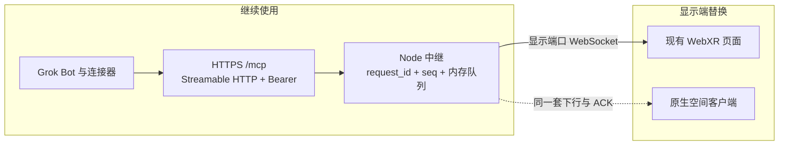

# 原生空间评审与精炼计划

> 后续联调更新：阶段 B / C / E / D 的原生主体已同签名安装，经具名 Tunnel 取得三个工具的原生回执。用户新增宽屏网页并排共存、紧凑右侧布局要求，更新了下文原评审的阶段边界及固定坐标策略。真实 VR 投屏已确认并排显示，面板与模型抓取 / 拖动和显示授权恢复已有设备自动化证据；网页语音工具联动仍待验收；原生 MCP 迁移顺序不变。最新状态见[决策](05-decisions.md)与[工程说明](../apps/quest-app/spatial/README.md)，不以实现完成关闭下面的验收项。

> 2026-11-01。本文对照 `main`、主线分支 `cursor/mcp-relay-web-display-2d84`（草稿 PR #1，检查点 `dca4f9e`）和本分支已记录的 Quest 本机方案。开始阅读时的分支 HEAD 是 `ab33f4c`。推送前已快进到 `f3fc808`，下文按这个最新 HEAD 复核。结论先写。平台说法分成已核对与未核对；未打开的页面不写成已证实。

## 结论

原生空间层可以替换当前 WebXR 显示页，并继续使用同一套 MCP 工具和中继回执。显示客户端主动连接现有中继，消费 `show_scene`、`render_panel`、`clear` 以及 `request_id`、`seq`、ACK、快照。P50 ≤1.5 秒、P90 ≤2.5 秒至今没有头显样本。

`f3fc808` 已把语音入口改成同一 APK 任务栈里的官方网页。默认是浏览器 Custom Tabs，复用浏览器登录；WebView 是独立登录的备用页。用户已确认 `0.3-browser` 的网页登录和基础语音。这次确认没有工具调用、通话时长或延迟数字。改包 / Root 已停止，第三方安装包的 Google Play 限制留在历史记录里。正式本机 MCP、MR 和恢复仍待实现。

2026-11-01 机主已拍板阶段 1：网页语音调用现有 `/mcp`，由头显显示端按同一套 ACK 画出 `show_scene`、`render_panel`、`clear`，并返回 `delivered: true`。运行时定为 Spatial SDK + Compose。把 MCP 迁入 APK 仍是更后的终点，排在这次头显回执之后。Quick Tunnel、重启后不补发旧命令、不回写 `pose`、网页前台不要求系统窗口，都不阻塞阶段 1。桌面 `delivered: true` 和诊断健康回环仍然不能代替头显回执。决定全文见 [决策](05-decisions.md)。

## 对照范围

| 基线 | 本轮看到的内容 |
|---|---|
| `main`（`7cd779e`） | 原生 app、本地唤醒声纹、VPS 上的 Caddy + Node。公网段落标着「待 VPS 改版更新」。首包从说完最后一个音频样本算到头显可见正文 |
| 主线 `cursor/mcp-relay-web-display-2d84` | 已实现中继、三个显示工具、桌面 three.js / WebXR。六段里程碑：本地协议、显示闭环、WebXR 会话、交互占位、托管端闭环、正式 VPS。语音留在托管端 Grok Bot |
| 本分支 `ab33f4c` | 含上述检查点，另有 Quest 本机方案、Tunnel 诊断记录，并删除了 VPS 示例和原来的六段里程碑页 |
| 本分支 `f3fc808` | 在 `0.3-browser` 用 Custom Tabs 打开官方网页，WebView 备用。用户验收网页登录和基础语音。20 项健康服务断言与 18 项网页策略断言有记录。未改中继，未接入正式 MCP / MR |

2026-11-01 的实机事实，和代码、主线记录一致：

- 三个工具经连接器返回 `status: rendered`、`delivered: true`。证据在桌面显示页，见 [验证记录](03-validation-baseline.md)。头显沉浸画面、实机手柄和键鼠仍未验收。`f3fc808` 没有重跑这三次调用。
- 中继进程内 `seq` 从 1 递增，队列、幂等、场景和配对都在内存。进程重启后新进程从 1 重新计数。主线里程碑里，服务更新并重新配对后的两次调用序号就是 1、2。重连补发活不过重启。
- 当前公网入口是 Cloudflare Quick Tunnel，每次新建都会更换主机名。本分支后来的具名 Tunnel 只服务于隔离健康探针，中继 README 写明探针不连接本服务。两条通道不能并成一个「公网已经稳定」。
- `0.3-browser` 的网页登录和基础语音有用户确认。同任务栈、页面返回、麦克风授权和音轨释放另有自动化记录。备用 WebView 的登录存储仍独立。这些证据停在语音体验，没有接到 `show_scene`、`render_panel` 或 `clear`。

## 复用与替换

| 部件 | 精炼计划中的处置 |
|---|---|
| 工具名与结果字段 | 继续使用。`queued` 仍表示等待确认，`delivered: true` 仍只表示显示端已 ACK |
| `/mcp`、静态 Bearer、两种协议时期 | 继续使用。原生客户端不实现 MCP server，也不解析 JSON-RPC |
| 显示配对、`/ws`、单活动连接、关闭码 `4401` / `4410` | 继续使用。原生客户端替换浏览器成为那一个活动显示端 |
| WebXR 页面 | 保留为协议对照，直到原生客户端在头显上达到同样的回执。它不再是唯一的产品显示端 |
| 正式 VPS | 六段里程碑的最后一段仍未做。本分支删掉示例，只说明仓库里暂无部署材料，不说明该段已关闭或已否决 |
| 官方网页 Custom Tabs | `f3fc808` 已作为语音入口。它复用浏览器会话，由浏览器进程显示。原生空间场景另外实现，不把这个页面嵌进面板 |
| Quest 本机 MCP 与内置 Tunnel | 更后的迁移。阶段 1 先用现有中继闭合工具环。诊断证据保留在 [03](03-validation-baseline.md)，尚未接入现有 `/mcp` 队列 |
| 本地唤醒、声纹、自建语音、改包 / Root | 不在当前范围。安装包登录实验已经停止 |

原生客户端要连的是显示端口，不是公网 `/mcp`。主线调试把 Quick Tunnel 指到只提供 `/mcp` 的端口；显示页、配对和 WebSocket 留在另一个 localhost 端口。头显在开发期靠 USB 转发到达该端口。没有这条显示路径时，客户端不能把自己标成已连接。

## 平台核对

查阅日期 2026-11-01。下表路径属于对应机构的公开文档，不是本仓库链接。

| 判断 | 核对结果 |
|---|---|
| Horizon OS 同时提供四条官方路径：普通 Android 与 Spatial SDK、Unity / Unreal、原生 OpenXR、WebXR | 已核对。入门页把 Kotlin Spatial SDK 放在工具 / 生产力类，把 OpenXR 放在自定义引擎，把 WebXR 放在浏览器 |
| Spatial SDK 用一个沉浸 Activity，在场景里注册并动态生成多块 2D 面板，Compose 可作为面板内容；面板是场景实体 | 已核对架构、注册、生成和 Compose 页。面板可以抓取，并用 `IsdkPanelResize` 缩放。它们不是系统级独立窗口 |
| 透视合成与读取相机帧是两件事 | 已核对。Spatial SDK 用 `enablePassthrough` 做合成，天空盒可见时透视不可见。Passthrough Camera API 才提供前向 RGB，概览更新于 2026-10-07：Quest 3 / 3S、Horizon OS v74+，`CAMERA` 或 `HEADSET_CAMERA` 二选一，并要求系统透视开启。WebXR 的 `immersive-ar` 只合成透视，官方混合现实页写明拿不到透视像素 |
| Quest Browser 的沉浸模式是 WebXR | 已核对。Browser 7.0 起支持沉浸式 6DOF WebXR，正式站点要 HTTPS，开发可用 localhost。现有页面请求 `local-floor`，并在 VR / `immersive-ar` 之间选择。头显上是否真能进入会话，仓库没有实测 |
| Unity 路线应使用 Unity OpenXR 插件；Oculus XR 插件已弃用并计划移除 | 已核对 Meta 的 Unity OpenXR 页与兼容页 |
| 跨会话的真实空间锚点在原生 OpenXR 与 Unity 有文档 | 已核对 OpenXR 持久化扩展和 Unity 的保存锚点页。锚点 UUID 由应用自己映射到内容。Spatial SDK 的 Focus 示例把物体位姿存进本地数据库；本轮没有找到 Spatial SDK 直接调用该 OpenXR 持久化扩展的文档 |
| Layout SDK 适合非沉浸应用在主窗口周围放辅助窗口 | 已核对。早于 Horizon OS v207 会回退。组合占位受 1600×960 dp 约束，父窗口关闭会销毁子窗口。Compose 向平台询问容量；当前 React Native 集成预留两个槽位。这不是 Spatial SDK 的面板上限 |
| 沉浸应用可与二维窗口同时可见，同一时刻只有一个应用接收输入；摘头显并达到 Auto Sleep 后暂停 | 已核对 Unity 生命周期页（2026-10-07）。失去输入焦点与 Application Pause 在该页是两件事。订阅 API 是 Unity 的。Spatial SDK Activity 是否收到同一组暂停事件，本轮未另开专页 |
| Quick Tunnel 每次创建更换主机名，无在线保证，不支持 SSE，同时在途请求超过 200 个返回 429 | 已核对 Cloudflare Quick Tunnel 页。WebSocket 升级在相邻的隧道说明里被描述为可用；本仓库显示端的 WebSocket 当前不走这条公网隧道 |
| Grok Bot 的 Android 伴侣共享 Bot、对话、连接器和云电脑，并有语音入口；FAQ 把它与另一款 Grok 聊天产品区分开。MCP 可由 URL 或云电脑命令接入 | 已核对移动、FAQ、电脑与应用三页。下载说明指向 Google Play，要求的是手机系统，页面没有 Quest / Horizon OS。安装包登录失败留在 [03](03-validation-baseline.md) 的历史记录；当前语音入口是官方网页 |
| 默认 Custom Tabs 与浏览器共享登录状态和网站权限；WebView 不共享这套状态。Custom Tab 由浏览器提供 | 已核对 Chrome Custom Tabs 概览：默认共享浏览器的 cookie 与权限，临时 Custom Tab 才会隔离会话。WebView 概览写明它不与浏览器共享数据。这些页面没有把 Custom Tab 写成可放进其他应用布局的 View。同一任务栈是本分支的设备记录 |
| Horizon OS 不含 Google Mobile Services | 已核对同一入门页 |

未核对，不能写成限制或能力：

- Spatial SDK 0.10.0 说明页存在，其中包括面板抓取和 MRUK world-locking。本轮没有确认它是查阅当日的最新版本。
- 目标头显的 Horizon OS 功能版本、系统窗口剩余容量、Spatial SDK 与 Custom Tab 的焦点切换。Chrome 的共享会话说明不能单独证明这台 Quest 浏览器的实现；同任务栈和已有会话以 [03](03-validation-baseline.md) 的设备记录为准。
- 用 WebView 把现有 three.js 页面嵌进原生壳之后，能否进入沉浸 WebXR。官方路径把浏览器和原生分开写。
- 现有实现的工具结果用单个 JSON 对象返回，`GET /mcp` 为 405。Quick Tunnel 已能完成这种 JSON 调用。若连接器改为必须使用 SSE，结果未测。
- Spatial SDK、cloudflared 与其依赖的完整许可、通知文件和再分发义务。诊断记录里的许可清单不能代替正式产品审查。
- MCP 规范里的图像结果条款。本轮未重开该页；显示工具也还没有视觉输入。

## 可行性与缺口

Spatial SDK + Compose 能覆盖当前三个工具的显示形态：多块文本面板、一个预设或一个 glTF、透视作为背景。它覆盖不了的是另一类需求：面板在别的应用获得焦点后仍作为系统窗口留在房间里。那要改评 Layout SDK 或普通 Android 多窗口，并接受系统重新摆放窗口。Hybrid 文档描述的是同一个应用里的二维 Activity 与沉浸 Activity，不能推出可以嵌入或控制头显上的 Grok Bot。

Grok Bot 官方能力支持「语音留在 Grok、显示走 MCP URL」。`f3fc808` 把这台头显上的语音落到官方网页，并用用户确认去掉了「必须先登录第三方安装包」这个阻塞。网页语音仍要经过托管连接器才会到达工具。连接器今天打到的是现有中继；本机 MCP 还没有服务可接。显示层可以继续用这条已经测过的 HTTPS MCP，不必等 APK 内的工具进程。

现有锚点语义小于协议字段的字面意思。`anchor` 允许 `world`、`floor`、`head`、`front`、`left`、`right`，页面把它们实现成固定偏移；`world` 与 `floor` 相同，`head` 不跟随头部。原生客户端第一阶段应复现这组偏移。直接做成房间锁定或头部跟随，会让同一条工具调用在两个显示端上位置不同。

缺口集中在这些地方：

- `f3fc808` 证明了网页登录和基础语音，没有证明语音能触发三个显示工具，也没有原生显示客户端或头显沉浸会话样本。Custom Tab 与沉浸 Activity 的焦点、音频共存尚未测量。
- 显示 WebSocket 还没有可脱离 USB 的正式入口。Quick Tunnel 的主机名每次新建都变，连接器要跟着改。
- `seq`、场景和幂等随进程消失。重启后的补发只能靠快照对齐当前内存，不能恢复重启前的未 ACK 命令。
- `interaction` 只留在中继内存，抓取、缩放和关闭不会回到 Grok。
- 首包没有 P50 / P90。诊断健康请求大约 1.05–1.12 秒，只说明那次探针的 HTTP 往返。
- 本分支的里程碑 0–6 记录的是本机 Tunnel 路线。它与主线六段不是同一张清单，不能逐项对号入座后宣布完成。

## 与六段里程碑和延迟目标

| 主线阶段 | 与精炼计划的关系 | 当前证据 |
|---|---|---|
| 本地协议 | 原样复用 | 自动化与公网 Bearer 已有记录。原生客户端不重做协议 |
| 显示闭环 | 原生客户端必须在头显上重新取得同一 ACK | 桌面已完成。头显页面曾打开，沉浸闭环未完成 |
| WebXR 会话 | 浏览器对照保留。选定原生运行时后，另立「原生空间会话」验收，模拟 WebXR 不算原生通过 | 仅有模拟测试 |
| 交互占位 | 原生选择、抓取先映射到现有 `interaction` | 自动化已覆盖，没有外部投递 |
| 托管端闭环 | 连接器保持不变。网页语音已在头显上验收，但没有从该会话发出三次工具。显示端换成头显后要重测 | 桌面三次 `rendered` / `delivered: true`。网页语音验收不含这次调用 |
| 正式 VPS | 仍待做。稳定入口是这一段的事情；Quick Tunnel 与诊断用的具名健康隧道都不是这段的通过证据 | 本分支已无部署示例；主线仍只有示例且未部署 |

首包目标保持 P50 ≤1.5 秒、P90 ≤2.5 秒，至少 100 次有效样本后才计算分位数。2026-11-01 已拍板：阶段 1 从工具调用发出计到头显上该 `seq` 首次可见。确认提示、心跳和 `queued` 不算可见。语音结束到可见可以另列一栏，不阻塞阶段 1，也不替代这个起点。样本不足时写明次数和失败次数，不把单次健康检查或本地往返写成达标。门槛数字本身不动。

## 精炼架构

日常链路保持为：Grok Bot → 连接器 → `https://<PUBLIC_BASE_URL>/mcp` → 中继 → 一个已配对的显示端。正式入口仍只公开 `/mcp`。Bearer 与显示配对口令分开。TLS 不代替任一凭据。

原生客户端是显示端。它在头显上维持空间场景，把下行命令变成面板和三维对象，在画面更新之后 ACK。它不持有模型 API 密钥，不启动第二套语音，不监听公网 MCP。

阶段 1 的公网入口继续用 Quick Tunnel，只转发 `/mcp`。主机名变化时更新连接器配置，不把稳定主机名写成当前阻塞项。显示配对和 WebSocket 继续走开发路径，例如 USB 转发到显示端口；不把 Quick Tunnel 扩大到 `/ws`、配对或显示页。

把 MCP 迁入 APK 排在头显 `delivered: true` 之后。那时要替换的是谁持有队列和 `seq`。健康探针的 200 响应不包含这套语义。阶段 1 也不要求进程重启后补发旧命令。

## 分阶段任务

| 阶段 | 任务 | 完成时能证明的事 |
|---|---|---|
| A | 本文与 [决策](05-decisions.md) 冻结阶段 1 契约 | 书面语义已拍板。本步不改中继代码 |
| B | 打通头显到显示端口的路径。开发期用 USB 转发 | 客户端能配对并保持唯一活动连接；公网只接受 `/mcp` |
| F | **阶段 1 当前关口。** 网页语音经 Quick Tunnel 调用现有 `/mcp`，头显执行三个工具 | 每个工具 `rendered` 且 `delivered: true`，画面与 `request_id`、`seq` 一致。不要求换稳定主机名 |
| C | Spatial SDK + Compose 沉浸场景承接同一协议：至少三块不同 `panel_id`、同 ID 更新、一个预设、一次 `clear` | 每个 `seq` 的画面与 ACK 一致。网页在前台时不要求面板仍作为系统窗口可见 |
| E | 选择与抓取只产生现有 `interaction`，不回写 `pose` | 中继内存有记录，Grok 对话不被这个事件触发 |
| D | 同一次进程内，5 分钟连续序号补发 | 不丢、不重复开窗。进程重启后不补发旧命令，缺持久化不算阶段 1 失败 |
| G | 后续：稳定主机名 | 连接器 URL 在进程重启后仍可复用。不阻塞 F |
| H | 后续：MCP 迁入 APK | 有队列、鉴权和回执的替代设计。排在 F 的头显回执之后 |

阶段 C 只使用 Spatial SDK + Compose，不并行开工 Unity。阶段 F 可以先用现有显示页取得头显回执；那次通过不代替阶段 C 的原生场景。阶段 F 与阶段 C 都服从同一 ACK 语义。

## 接口与协议

原生客户端消费中继已经实现的显示协议。字段细节以 [协议基线](04-protocol-baseline.md) 和当前代码为准。客户端不调用 `/mcp`。

### 配对与套接字

1. 向显示端口 `POST /api/device/pair`，正文为 JSON 对象，字段 `token` 是配对口令。成功时保存返回的 `session_token` 与 `expires_in`。口令错误为 401，过频为 429。会话默认约 900 秒。
2. 连接显示端口的 `/ws`。开发期页面使用与页面相同的主机。原生客户端使用配置里的显示基址，不把 MCP 基址拼成 WebSocket。
3. 连接后 5 秒内发送第一条 `auth`，否则服务端以 `4401` 关闭。
4. 收到 `auth_ok` 后才处理场景命令。服务端随后按 `last_seq` 补发或发送快照。
5. 第二台已鉴权显示端连上时，前一台收到 `4410`。收到 `4410` 后停止自动重连，只在使用者明确选择「切回」时再连接。`4401` 表示会话无效，需要重新配对。约 25 秒心跳，60 秒没有入站则断开。重连退避为 1、2、4、8、16、30 秒，并加 ±20% 抖动。

### 消息

每条消息都是 JSON 文本，包含 `v`、`session_id`、`request_id`、`seq`、`type`、`body`。`v` 固定为 1。标识字段是 1–64 位 ASCII 字母、数字、下划线或短横线。

客户端上行：

| type | 要点 |
|---|---|
| `auth` | `body.session_token` 与整数 `body.last_seq`（≥0）。本地没有画面时送 0，让服务端按现有队列重建 |
| `ack` | 只确认已经可见的命令 `seq`。确认是累积的：确认 N 会把尚未确认且序号 ≤ N 的命令都标成已显示 |
| `resume` | `body.last_seq` 为本地已应用的连续序号 |
| `ping` / `pong` | 与服务端心跳对应 |
| `interaction` | `body.kind` 为 `select` 或 `activate`，`body.target_id` 为面板 ID、预设名或 `model` |

服务端下行：

| type | 客户端行为 |
|---|---|
| `auth_ok` | 进入已连接状态。其 `seq` 是当前高水位 |
| `show_scene` | 替换整个三维场景，然后在可见后 ACK |
| `render_panel` | 按 `panel_id` 新建或替换一块纯文本面板，然后 ACK |
| `clear` | `scene`、`panel` 或 `all`。`panel` 使用 `panel_id`。完成后 ACK |
| `snapshot` | 用 `body.scene` 与 `body.panels` 替换本地画面，把本地序号改为这条消息的 `seq`。不 ACK。`reason` 现为 `gap` |
| `ping` | 回复 `pong` |
| `interaction_ok` / `interaction_rejected` | 只更新本地调试状态 |

命令串行执行。前一条还没可见时不确认后一条。模型下载或解析失败时停止确认并保持未连接状态，避免累积 ACK 把失败记成已显示。快照与命令使用同一套替换规则，避免「快照已画出、随后补发又建一块同 ID 面板」。

### 场景正文

`show_scene` 的正文含 `preset` 或 `model_url` 之一、`anchor`、规范化 `pose`。预设为 `grid`、`orbit`、`crystal`、`pedestal`。模型 URL 由中继限制为允许来源上的 https，且路径以 `.gltf` 或 `.glb` 结尾；中继不下载模型，客户端自己下载。失败时不 ACK。

`render_panel` 的正文含 `panel_id`、`title`、`text`、`anchor`、`pose`。正文拒绝尖括号。同一 `panel_id` 是更新，不同 ID 并存。缺省锚点在进入中继后已规范成 `front`。

`pose.position` 各分量在 -10 到 10，`rotation` 各分量在 -360 到 360，`scale` 在 0.1 到 3。缺省为零位移、零旋转、缩放 1。

当前页的锚点偏移是：`world` 与 `floor` 为原点，`head` 为高度 1.6，`front` 在前方 1.2，`left` / `right` 在两侧。单位与页面一致，按米理解即可，它们还不是持久空间锚点。原生第一阶段复现这张表。

### 序号与重启

服务端从 1 分配 `seq`。补发条件是：缓冲里大于 `last_seq` 的消息仍然连续。出现空档，或客户端序号高于服务端高水位时，发送快照而不是跳号。缓冲默认保留 100 条、5 分钟。过期未 ACK 的幂等结果变为 `expired`。场景状态在进程活着时仍留在内存，所以快照可以在命令已过期时恢复「当前画面」，不能恢复重启前的画面。

进程重启后高水位回到 0，场景为空，旧 `request_id` 不再幂等。客户端若仍提交重启前的 `last_seq`，会收到一张空快照或重启后的新快照，并必须采用快照序号。此后第一条新命令的 `seq` 为 1。客户端应丢弃重启前未完成的本地命令，不把它们再 ACK 到新进程。

同一 `request_id` 在 5 分钟内、正文相同，返回已有结果；正文不同则拒绝。重启使这张表消失，因此重启后的重试会被当成新命令。连接器若自动重试，头显可能再次执行已经在重启前显示过的内容。这是当前协议的边界，不是原生客户端能单独补上的持久化。

工具调用默认最多等 2 秒。超时结果是 `queued`、`delivered: false`。离线或进程正在退出时可以是 `offline`。这些状态都不是已显示。

## 验收标准

每次记录设备与系统版本、客户端构建、中继提交、入口类型、样本量、失败和超时次数。省略令牌、临时主机名、序列号和面板正文。未运行的项目写「未运行」。

| 编号 | 标准 | 通过条件 |
|---|---|---|
| V1 | 三次工具 | 头显上 `show_scene`、`render_panel`、`clear` 各自返回 `rendered` 且 `delivered: true`，画面与该 `request_id`、`seq` 一致 |
| V2 | 多面板 | 三个不同 `panel_id` 同时可见；重复同一 ID 只保留一块；`clear` 的 `panel` 只移除指定 ID |
| V3 | 失败不虚报 | 模型不可用时不 ACK，工具结果保持 `queued` 或错误，画面不出现该模型 |
| V4 | 短时补发 | 断开后在队列有效期内以最后连续序号重连，只补未应用命令，面板数量不因补发增加 |
| V5 | 重启 | 后续项。阶段 1 不要求重启后补发旧命令。若客户端仍提交旧 `last_seq`，采用快照序号且不把旧命令 ACK 到新进程即可；缺跨重启持久化不算阶段 1 失败 |
| V6 | 单连接 | 第二台配对设备接管后，第一台收到 `4410` 并不再自动重连 |
| V7 | 入口隔离 | 无 Bearer 的 `/mcp` 为 401；公网入口上的显示页、`/ws`、配对路径为 404 |
| V8 | 交互边界 | 选择或抓取只产生 `interaction`。阶段 1 不回写 `pose`，也不因此产生新的工具调用 |
| V9 | 首包 | 从工具调用发出计到该序号首次可见。有效样本至少 100 次后才报告 P50、P90。门槛仍是 1.5 秒与 2.5 秒。语音结束到可见可另列，不阻塞。此前只公布次数和失败数，不公布达标结论 |
| V10 | 空间语义 | 若实现超出固定偏移的头部跟随、房间锁定或跨会话锚点，单独列表验收。未实现则保持与当前页面同一偏移 |

阶段 F 在头显上通过 V1，并开始 V9 的计数。阶段 C 通过 V1–V3 与 V8。阶段 D 的阶段 1 范围只要求 V4 与 V6；V5 不阻塞。V9 在满 100 次之前保持「未测量」。V10 超出固定偏移的空间语义属于后续。

## 风险

- 长期拓扑仍把 MCP 放在 Quest。阶段 1 已改为先用现有中继。不读 2026-11-01 决策时，会把迁入 APK 当成当前关口。
- 累积 ACK 会把较早的失败也标成已显示。客户端必须按序确认。
- 内存队列在重启、过期和满 100 条时丢历史。阶段 1 不要求补回这些命令。跨重启持久化以后再做，不能用显示端本地缓存代替。
- 沉浸应用暂停或失去输入焦点时，面板可能不可见或不能交互。把「Service 仍在」或「WebSocket 仍在」写成画面正常，会重复现有误判。
- 阶段 1 已决定：网页在前台时，不要求面板作为系统窗口继续可见。以后若改这个决定，再评 Layout SDK。
- 网页语音的用户确认容易被写成工具闭环。确认范围只有登录和基础语音，没有 `delivered: true`，也没有 P50 / P90。
- Custom Tab 在浏览器进程里。沉浸 MR 获得输入焦点时，网页会话是否继续收音、Tunnel 是否仍可回执，都还没有联合样本。
- 诊断 APK 的执行身份、短时生命周期和约 1 秒健康往返，容易被误写成 MCP 延迟或正式组件完成。
- Quick Tunnel 的主机名仍会在每次新建后变化。阶段 1 接受更新连接器，不把稳定主机名或正式 VPS 材料当成阻塞项。SSE 仍不受支持；今天的 JSON 成功不覆盖将来的流式响应。

## 已拍板（2026-11-01）

下列决定已经生效，不再作为待选项。阶段 1 与后续的分界以 [决策](05-decisions.md) 为准。

| 事项 | 阶段 1 | 后续 |
|---|---|---|
| 工具环 | 网页语音 → 现有 `/mcp` → 三个工具 → 头显 `delivered: true` | MCP 迁入 APK |
| 运行时 | Spatial SDK + Compose | 不并行 Unity |
| 网页前台 | 不要求面板作为系统窗口继续可见 | 若改为要求共存，再评 Layout SDK |
| 公网入口 | 继续 Quick Tunnel，不阻塞端到端 | 具名 Tunnel 或稳定主机名 |
| 重启 | 不要求补发旧命令 | `seq` 持久化 |
| 首包 | 从工具调用发出计时。P50 ≤1.5 秒、P90 ≤2.5 秒，满 100 次才计算 | 语音结束到可见只作另列，不阻塞 |
| 面板移动 | 只上报现有 `interaction`，不回写 `pose` | 回写位姿另定版本 |
| `f3fc808` | 不改写作者，不用 force-push | 无 |

更早已经定下、本次不重开的事项：语音使用官方网页；默认 Custom Tabs，WebView 只作独立登录备用；用户确认登录和基础语音通过；改包 / Root 停止。桌面三次工具回执、中继内存序号从 1 开始、诊断 APK 的短时健康回环仍然有效，但不等于阶段 1 已经通过。

## 资料路径

| 主题 | 路径 |
|---|---|
| Horizon OS 四条开发路径与 GMS | `/essentials/quick-start/` |
| Spatial SDK 架构、面板、Compose、抓取与缩放 | `/documentation/spatial-sdk/spatial-sdk-architecture/`；`/documentation/spatial-sdk/spatial-sdk-2dpanel-registration/`；`/documentation/spatial-sdk/spatial-sdk-2dpanel-spawn/`；`/documentation/spatial-sdk/spatial-sdk-2dpanel-compose/`；`/documentation/spatial-sdk/spatial-sdk-isdk-panels/`；`/documentation/spatial-sdk/spatial-sdk-resize-panel/` |
| Spatial SDK 透视、MRUK、本地位姿示例、0.10.0 说明 | `/documentation/spatial-sdk/spatial-sdk-passthrough/`；`/documentation/spatial-sdk/spatial-sdk-mruk/`；`/documentation/spatial-sdk/focus-data-persistence/`；`/downloads/package/meta-spatial-sdk/0.10.0/` |
| Passthrough Camera API 概览 | `/documentation/spatial-sdk/spatial-sdk-pca-overview/` |
| Unity OpenXR 与生命周期、锚点 | `/documentation/unity/unity-xr-plugin/`；`/documentation/unity/unity-and-openxr-compatibility/`；`/documentation/unity/unity-lifecycle/`；`/documentation/unity/unity-spatial-anchors-persist-content/` |
| 原生 OpenXR 空间锚点 | `/documentation/native/android/openxr-spatial-anchors-overview/` |
| WebXR | `/documentation/web/webxr-overview/`；`/documentation/web/port-vr-xr/`；`/documentation/web/webxr-mixed-reality/` |
| Layout SDK 与窗口容量 | `/documentation/android-apps/meta-vr-layout-sdk/`；`/documentation/android-apps/meta-vr-layout-priority/`；`/documentation/android-apps/spatial-sim-multi-window/` |
| Quick Tunnel | `/tunnel/get-started/quick-tunnels/` |
| Grok Bot | `/grok-bot/mobile`；`/grok-bot/faq`；`/grok-bot/computer-and-apps` |
| Custom Tabs 与 WebView | `/docs/android/custom-tabs`；`/docs/android/custom-tabs/guide-ephemeral-tab`；`/docs/webview` |
