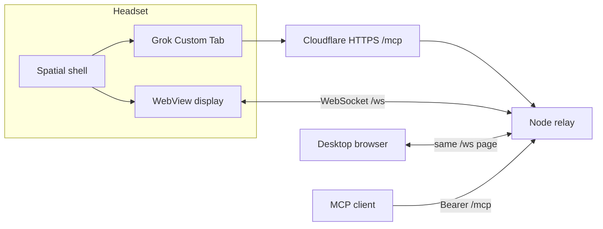

# 双轨显示架构

2026-11-01。本文件描述 `refactor/display-two-track-2026-11-01` 的目标结构。它不把桌面 `delivered: true` 写成头显验收，也不改 Cloudflare DNS、WAF、账号或具名 Tunnel 资源。

## 为什么不用 A-Frame

显示页需要同时满足：桌面浏览器刷新即可调试、Quest 浏览器沉浸会话、手柄与手部、纯文本面板、glTF，以及现有 WebSocket 回执。React Three Fiber、`@react-three/xr`、`@react-three/uikit` 和 `@react-three/drei` 分别覆盖这些部分，并且可以和独立的协议模块放在一起。A-Frame 的实体 HTML 适合快速搭场景，但面板、手柄/手和 glTF 加载要再接另一套组件，不能更直接地保留现有回执语义。因此继续使用上述 React 栈，而不是改用 A-Frame。

## 两条轨道

| 轨道 | 负责 | 不负责 |
|---|---|---|
| 网页显示 | 预设场景、锚点偏移、面板文字、清除、WebXR 沉浸、WebSocket 配对与 ACK | MCP 鉴权、Cloudflare、Grok 登录 |
| 原生壳 | 把 Grok 官方网页（Custom Tabs / `GrokWindowActivity`）和网页显示（WebView 面板）放在同一头显会话里 | 自绘网格、自建语音、本机 MCP |

保留不变的外部契约：

- 工具名 `show_scene`、`render_panel`、`clear` 和各自的 `inputSchema`。
- 中继的 `seq`、幂等、队列、单个活动显示连接，以及关闭码 `4410` / `4401`。
- `delivered: true` 只在显示端 ACK 之后出现。
- 公网入口只转发 `/mcp`。Bearer 与显示配对口令仍然分开。
- Quick Tunnel 仍是这条重构的连接方式。具名 Tunnel 的执行计划见 [具名 Tunnel 计划](08-named-tunnel-plan.md)。本分支没有改 DNS、WAF 或云端配置。仓库里已有的说明见 [config/cloudflared/README.md](../config/cloudflared/README.md)。

## 数据流



桌面浏览器和头显 WebView 加载同一份 Vite 构建。原生壳不自绘场景。机主已要求删除 `DisplayEngine` 和四个预设 GLB；`RelayClient` 只保留配对和显示 WebSocket，不再保存场景状态。头显安装推迟到下一次实机，下面的步骤保持不变。

## 开发与调试

1. 在仓库根目录 `npm ci`，然后 `npm start`。`start` 会先执行 Vite 构建，再启动现有 Node 进程。
2. 桌面浏览器打开 `http://localhost:8787/`，输入显示配对口令。Mac 上刷新页面即可看到预设、面板和清除；不需要头显。
3. 用临时 Bearer 调用 `/mcp`。只有页面 ACK 后 `delivered` 才为 `true`。
4. 沉浸按钮在支持 WebXR 的 Quest 浏览器里进入 VR 或透视 AR。桌面没有头显时按钮保持不可用，页面仍可调试。库默认的 localhost Quest 模拟器已关闭，避免它替换桌面画面。
5. 头显步骤见文末。没有设备时不能把本页的桌面结果写成头显通过。

## MCP

`@modelcontextprotocol/sdk` 的 npm `latest` 仍是 1.32.2，没有 2.x 版本。官方 2.x 拆成 `@modelcontextprotocol/server` 2.4.0 与 `@modelcontextprotocol/node` 2.1.2。`/mcp` 使用前者的 `createMcpHandler`（2026-07-28，`legacy: 'reject'`）以及后者的 `NodeStreamableHTTPServerTransport`（有会话的 2025-11-25）。

SDK 的默认 2025 回退是无会话的，并且 DELETE 返回 200。本服务在传输层外保留原来的空 204，并自己保存会话，使 `initialize`、`notifications/initialized`、会话头和删除后的 404 保持可用。Bearer 401 正文仍在进入 SDK 之前由中继生成。

已知差异，需要机主确认连接器是否依赖旧字段：

- `server/discover` 的 `supportedVersions` 只列出现代修订 `2026-07-28`。`2025-11-25` 仍通过 `initialize` 协商，两条都在同一个 `/mcp`。
- 现代路径上不支持的版本错误 `-32022` 的 `data.supported` 同样只列出 `2026-07-28`。

工具输入 schema 与调用结果里的 `structuredContent` 保持原样。没有迁移到 Workers。

## 迁移笔记

- 手写 three.js 页面（`apps/web-display/main.js`、`xr.js`）删除。协议状态在 `src/session.js`，画面在 `src/scene.jsx`。
- 预设 `grid`、`orbit`、`crystal`、`pedestal` 用 React 组件重画，锚点偏移与旧页面相同。外部 glTF 使用 `@react-three/drei` 的 `useGLTF`。面板文字使用 `@react-three/uikit`，命中区域仍是一块平面，避免字体加载失败时丢失点击。
- 原生 `WorkspaceActivity` 只放两个空间面板：控制页和显示 WebView，并继续用 `GrokWindowActivity` 打开官方网页。不把 Grok 放进 WebView，以便继续使用浏览器登录。
- `apps/quest-app/tunnel-probe` 继续单独构建。诊断服务的前台启动、日志线程和健康线程不再把运行时异常留在未捕获路径上；WebView 回调在 Activity 销毁后直接返回。

## 保留 / 替换 / 降级

| 路径 | 处置 |
|---|---|
| `services/relay/src/hub.js` | 保留。工具校验、队列、ACK、4410 仍在这里 |
| `services/vr-mcp-server/src/tools.js` | 保留。schema 与参数校验未改 |
| `services/vr-mcp-server/src/handle.js` | 替换为 SDK v2 传输适配 |
| `apps/web-display/src/*` | 新的 Vite + R3F 页面 |
| `apps/web-display/main.js`、`xr.js` | 删除 |
| `apps/quest-app/spatial/.../WorkspaceActivity.kt` | 替换为薄壳 |
| `apps/quest-app/spatial/.../GrokWindowActivity.kt`、`DisplaySessionStore.kt`、`HomeActivity.kt` | 保留；Home 文案改为网页显示 |
| `DisplayEngine.kt`、`DisplayEngineTest.kt`、`generate-presets.py`、四个预设 GLB | 删除。场景状态不再由原生核心保存 |
| `RelayClient` | 保留配对、刷新和 WebSocket。序号只在连接期间使用，不再调用已删除的场景引擎 |
| `apps/quest-app/tunnel-probe` | 保留并修明显崩溃点 |
| Cloudflare 账号、DNS、WAF、具名 Tunnel | 本分支不修改。下一步只见 [计划](08-named-tunnel-plan.md)，执行前逐项批准 |

## 头显操作

这些步骤需要机主在设备上执行。头显测试推迟；步骤保留在这里，本环境没有头显。

1. 用和已安装包相同的调试签名构建 `apps/quest-app/spatial`。CI 产物是临时签名，不能覆盖已登录的安装。
2. `adb install -r` 安装该 APK。不要为了换签名而卸载。
3. 开发机启动 `npm start`。需要 Quick Tunnel 时用现有的临时隧道命令，只把 `/mcp` 转到中继；不要新建具名 Tunnel。
4. `adb reverse tcp:8787 tcp:8787`，在连接页填写 `http://localhost:8787` 和显示配对口令。
5. 打开「Grok 与工作区」。Grok 仍走 Custom Tab。旁边的面板应加载网页显示；若已配对，壳会把会话交给页面。
6. 从托管连接器或桌面客户端调用三个工具，对照 `request_id`、`seq`、`delivered` 和实机画面。

抓取 `com.example.questvr.tunnelprobe` 的崩溃栈（诊断包和空间包共用这个应用 ID）：

```sh
adb logcat -b crash -d
adb logcat -d -t 4000 | grep -E 'com\.example\.questvr\.tunnelprobe|AndroidRuntime|FATAL EXCEPTION'
```

崩溃发生后进程已经退出时，优先看 crash 缓冲区。若要在复现时持续记录：

```sh
adb logcat -c
adb logcat -b crash,main -v time com.example.questvr.tunnelprobe:V AndroidRuntime:E ActivityManager:E '*:S'
```

不要把原始 logcat、序列号或隧道地址放进仓库。
