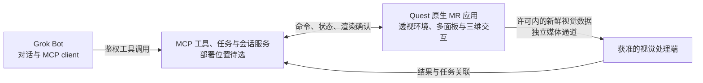

# Quest 原生 MR 空间助手方案

> 2026-11-01。原生应用方向已确定，具体技术栈与服务部署方式待选。本文供需求核对，尚未批准实施新方案。
>
> 待 VPS 改版更新：本轮仅研究和提交文档，不改变现有服务、监听端口或公网入口。

## 产品体验与确定范围

目标是由 Grok Bot 驱动、具有钢铁侠风格的原生 Quest 透视 / MR 空间助手。用户在同一个体验中看见现实环境，唤出、摆放和管理多个空间面板；助手在许可范围内使用新鲜的视觉上下文理解现场，并把结果呈现在这些面板或三维内容上。视觉能力与透视模式统一设计、联动和验收。

| 已确定的需求 | 预期行为 | 设计边界 |
|---|---|---|
| 原生空间工作区 | 多个面板能独立打开、移动、缩放、更新和关闭，可结合三维对象 | 需要选定原生技术栈；系统独立窗口与 App 内空间面板不是同一能力 |
| 透视模式与视觉联动 | 同时看现实与助手内容，按会话许可取得现场视觉上下文并呈现结果 | 透视合成与读取真实帧是两项底层依赖，必须一起验证体验 |
| Grok Bot 联动 | Grok 通过 MCP 操作内容，获取明确的执行状态 | 接收、排队、渲染和视觉处理完成分别确认 |
| 脱离 MBP 运行 | MBP 用于开发调试，日常助手不依赖它承载 MCP 中继 | 比较 Quest 本机 MCP 与常在线服务端两种部署方式 |
| 后台与扩展 | 任务、设备会话、布局和视觉状态可恢复，后续能增加工具与内容类型 | 服务在线不等于头显休眠时仍显示或持续取得新帧 |

已调通实现保存为检查点 `dca4f9e`，归档分支为 `archive/webxr-mvp-2026-11-01`；它仅用于追溯和回退，不是本文的新运行时路线。本方案位于 `docs/native-spatial-options-2026-11-01`。

本文区分**平台已文档支持**、**架构建议**和**待实机验证**。现有 MCP 工具与 ACK 规则可作为协议基础；原生工作区、透视视觉联动、独立运行和后台恢复尚未在本项目实现或验收。本轮没有检查实际 Quest 固件、安装 SDK、侧载应用或读取相机画面。

## 原生技术栈与建议

**建议优先验证 Meta Spatial SDK + Compose。**它更贴近同一 MR 场景内独立摆放多个助手面板、结合三维内容与透视的目标。原生方向已经确定；待选择的是具体原生技术栈，不是是否采用原生应用。

| 原生路线 | 官方资料支持的能力 | 适用条件与限制 |
|---|---|---|
| Meta Spatial SDK + Compose | 一个空间 Activity 内动态创建多个 Android / Compose 面板及三维实体，有面板抓取、缩放和透视路径 | 优先候选；面板属于本 App，不自动成为独立系统窗口。真实房间位置的持久恢复须先验证；来源 S1–S4 |
| 普通 Android + Compose、多 Activity | 多个 Activity 可成为系统管理的独立 panel，使用系统移动和缩放控件 | 如果与其他 App 的系统窗口共存是首要需求，优先比较此路线；不承诺 App 能精确指定每个系统窗口的房间坐标；来源 S5、S6 |
| Meta VR Layout SDK | 主窗口周围组织辅助窗口，适用于非沉浸 Android App | 适合主窗口加少量工具窗口；按组移动和系统布局，不适合把每块面板任意留在不同位置；来源 S7、S8 |
| Unity + OpenXR + Meta XR SDK | 多个 Canvas / 三维对象、交互、透视与持久空间锚点有官方路径 | 复杂三维动画、物理交互或引擎资源占比较高时评估；不自动产生系统级任意多窗口；来源 S9、S10 |

Spatial SDK 可在一个空间 Activity 中动态创建多块面板。MRUK 有房间模型、场景锚点和 world-locking 支持，但本轮没有核实到可直接采用的 Kotlin 自建锚点完整跨会话保存恢复示例。保存 XYZ 布局不等于重启后回到同一真实墙面；内容恢复、相对布局恢复和真实位置恢复分别验收。来源 S1–S4。

Layout SDK 的真正空间窗口要求对应系统能力，早于 Horizon OS v207 使用回退；组合占位受 1600×960 dp 范围约束，父窗口关闭会影响辅助窗口。Compose 使用平台可用容量，React Native 当前预留两个槽位；“主窗口加两个重要辅助窗口”不能写成所有路线的统一数量上限。来源 S7、S8。实际设备系统版本与容量本轮未检查。

Meta 推荐 Unity OpenXR，Oculus XR 插件已弃用。来源 S9。对以助手面板为主的产品，先比较原生 UI 与空间交互的开发成本，再决定是否引入完整引擎。透明 HUD、文字清晰度、遮挡和舒适距离应在所选运行时实测，不能只用界面风格图作为验收。

系统窗口、App 内空间面板和远程电脑桌面要分别对待：后者需要额外的媒体采集、传输、解码及输入控制，窗口 SDK 不自动提供。若远程桌面的视频源来自 MBP，迁移 MCP 入口不能消除这项媒体源依赖。

## 原生联动架构

以下为架构建议，尚未实现。Grok 保持对话与 MCP client 的角色；本项目不增加模型 API 客户端。

图中的视觉处理可以位于设备或用户选定的处理端，不表示新增了已部署服务。显示控制与媒体数据分开承载；后台服务位置按下一节选择。

| 协议与状态 | 原生端设计要求 |
|---|---|
| `render_panel` 与稳定 `panel_id` | 同 ID 更新，不同 ID 建立不同面板；创建、关闭和资源释放由统一状态管理器负责 |
| `show_scene` 与 `clear` | 原生端声明支持的内容类型，保持场景与指定面板清除语义；不支持时明确返回结果 |
| `request_id`、`seq`、快照和 ACK | 按序应用并去重，资源准备与渲染完成后才确认；`queued` 不等于已显示 |
| 移动、缩放、关闭与选择 | 定义用户本地修改与服务期望状态的版本关系，避免重连恢复旧位置或复活已关闭面板 |
| 多窗口会话 | 一个应用级连接管理器分发状态给各面板 / Activity，不让每块窗口分别抢占活动显示连接 |

现有 `interaction` 只在中继留存；移动、尺寸变化、关闭及反馈给 Grok 的机制均需新增设计，不能当作已经实现。协议基础仍以 [MCP 契约](04-mcp.md)为准。

## 服务位置：Quest 本机与常在线服务端

**建议优先比较常在线 MCP / 中继加 Quest 主动连接。**这条路线能去除 MCP 对 MBP 的依赖，并把长期任务与头显的前后台生命周期分开。Quest 本机 MCP 加 Tunnel 保留为具体实验候选，不承诺全天在线。

| 方案 | 调用与连接关系 | 收益 | 主要待验证项 |
|---|---|---|---|
| 常在线服务端 | Grok → HTTPS MCP / 中继；Quest 主动建立鉴权 WSS 设备连接 | 头显离线时入口和任务状态仍可用；MBP 不必在线 | 设备身份、显示与视觉控制协议、重连和过期；头显离线仍不能报告已显示 |
| Quest 本机 MCP + Tunnel | Grok → Cloudflare HTTPS 边缘 → Tunnel → Quest MCP 服务 → 原生 MR 应用；`cloudflared` 从 Quest 发起出站连接 | MCP 服务可随头显独立运行 | Android 兼容、进程生命周期、凭据保管、耗电、休眠及网络恢复 |

常在线路线沿用既定 VPS、Caddy、Node 和 systemd 目标研究，保留“待 VPS 改版更新”。已有 HTTPS 入口时未必需要 Tunnel。其他常在线主机或 LXC 只是条件候选，未选定部署。Quest 的设备通道是新增设计，不等于直接公开当前仅限 localhost 的 `/ws`、配对接口或显示页。

Quest 本机路线仍经过 Cloudflare 网络，不是点对点直连；Tunnel 提供通道，不实现 MCP 工具，头显还需要真正的 MCP server。Cloudflare Workers 是另一种云端计算平台，本研究不重新采用历史否决的 Worker 方案。来源 S11。

**可行性证据：**Cloudflare 官方下载有 Linux ARM64，但没有 Android / Horizon OS 发行包；CPU 同为 ARM64 不证明 OS / ABI 和启动方式兼容。Termux 维护方确实提供 `cloudflared`、适配的 Go 构建流程与 Node 包，因此存在实验路径，但不是 Cloudflare 或 Meta 对 Quest 的支持保证。Node 官方将 Android 列为不支持的平台，缺少当前 CI 测试。来源 S12–S14。可研究 Termux Node 或原生 Android HTTP MCP 服务，必须分别验证实际服务和隧道连接器。

本机路线需要在设备保管、撤销和轮换 MCP 服务凭据及 Tunnel 凭据；只承担客户端职责的 Quest 不需要服务端 MCP Bearer。Grok 的模型服务凭据不应搬进头显。不能通过放开现有接口来代替设备身份与会话授权设计。

如采用 Quick Tunnel，还要考虑临时地址、缺少在线保证及不支持 SSE 的限制；这不意味着使用 JSON 响应的 MCP 必然不通。稳定入口和未来传输形式须单独验证。来源 S15。没有延迟样本，不宣称“少一台设备”必然更快。

## 透视模式与视觉联动

产品流程是一体的：用户进入原生 MR 工作区，看见现实与助手面板；Grok 在会话许可范围内获得当前环境的视觉上下文；处理结果回到同一工作区。界面提供清楚的视觉联动状态和停止入口，后台 MCP 不能绕过用户许可。

**底层依赖：**系统透视合成让用户看到现实，App 读取真实帧则需要 Passthrough Camera API。后者基于 Camera2，提供前向 RGB 图像，适用于计算机视觉，不等于所有跟踪相机的原始数据，也不是包含界面的用户视角录屏。来源 S16、S17。这些依赖共同支撑 MR 视觉联动。

普通 Android 与 Spatial SDK 可使用 Camera2；Unity 当前教程推荐 MRUK 的 `PassthroughCameraAccess`，提供纹理、CPU 图像及相关姿态、时间戳、内外参，并处理暂停时的相机生命周期。分辨率和可用配置应运行时查询。来源 S17–S19。原生技术栈选择需要同时覆盖空间交互与这条视觉依赖。

**设备与权限条件：**2026-10-07 更新的概览列出 Quest 3 / 3S、Horizon OS v74+，并要求启用透视；权限为 `android.permission.CAMERA` 或 `horizonos.permission.HEADSET_CAMERA` 二选一，后者只授权头显透视相机。较早的原生教程要求两种权限，示例还列出 Android 14 / minSdk 34 与 v76+。应采用最新概览说明，并在目标固件验证实际授权、拒绝、撤销和恢复流程，不能合并为所有环境一律必须两种权限。来源 S17、S18。本项目尚未验证这些条件。

视觉数据需要关联来源、帧序号、采集时间与任务，空间对齐时再关联姿态和标定。恢复后必须验证新帧，不能把休眠前旧图像当作当前观察；处理中采用有界缓冲、限速和背压，避免旧画面挤占实时控制。

MCP 工具结果可包含图像，来源 S20；持续视频不应默认作为大段工具 JSON 传输。建议控制通道携带任务、状态和受限数据引用，图片或视频走合适的媒体通道。Grok 连接器消费图像结果或鉴权引用的能力还需验证，现有显示工具不能视为已具备视觉输入。

视觉处理可留在设备，也可发送到用户选定的处理端；目的地、保留时长与删除方式需要在实施方案中明确。建议默认不持久保存原始帧，停止联动后释放资源；本轮不拍照、录制或修改设备权限。

## 后台、生命周期与扩展性

至少分别观察五种状态：**MCP 入口可达、设备会话在线、命令已收到、画面已渲染、视觉新帧可用**。长期任务可以留在服务端等待设备恢复或明确过期，不能把服务在线当作用户仍在观看，或把收到命令当作渲染成功。

Meta 文档说明，具有接近传感器的头显摘下并达到 Auto Sleep 时间后会暂停应用，电源键关闭显示也会触发暂停。这不证明独立 Android Service 必然立即退出，也不保证 HTTP、Tunnel 或视觉帧仍可用。来源 S21。Android 还存在进程回收、Doze 网络限制与前台服务启动条件；前台服务不是无限保活开关。来源 S22、S23。

Android camera 前台服务在满足权限、服务类型和启动条件时可支持后台使用，但 `CAMERA` 受 while-in-use 限制，不能从后台任意启动。该通用能力不能推导特定 Horizon OS 与 `HEADSET_CAMERA` 组合在摘头显或休眠后持续提供新帧。来源 S23。MR 视觉联动暂停和 MCP / 任务服务可用应分别处理，不承诺休眠后持续采集。

| 扩展边界 | 建议责任 |
|---|---|
| 工具与能力 | 稳定工具语义，按设备声明内容、交互和视觉能力；新增类型不破坏已有结果与错误语义 |
| 任务与设备会话 | 分开记录长期任务、连接、超时、取消和恢复；采用退避重连与幂等处理 |
| 面板与布局 | 明确服务期望状态、设备实际状态和用户修改的版本关系，避免重放导致重复开窗 |
| 媒体与控制 | 分别限速与背压，视觉数据处理失败不能被显示 ACK 掩盖 |
| 后续设备 | 预留设备身份、能力选择和会话切换；不宣称当前已支持多设备同时同步 |

现有补发与幂等窗口为 5 分钟，补发最多 100 条，状态留在内存中。长时任务、跨服务重启恢复及真实空间锚点需要各自的持久化设计，不能直接复用短时队列作为全部状态库。网络切换与 Cloudflare 更新可能导致连接中断，恢复时需要核对会话代际、有效快照与过期请求。来源 S15 及 [MCP 契约](04-mcp.md)。

## 后续验证与需求核对

以下是获得实施授权后的建议步骤，本轮未执行：

| 阶段 | 最小验证内容 | 通过证据 |
|---|---|---|
| 1：原生 MR 工作区 | 同一透视场景中放置 3 个不同面板和一个三维对象，分别移动、缩放、关闭和选择 | 头显实际画面与操作记录；3 个是起点，不是窗口容量承诺 |
| 2：Grok 与视觉联动 | Grok 创建不同 ID 面板、更新同 ID、指定清除；在同一 MR 会话中完成一次许可内的现场视觉理解与结果显示 | 请求、序号、实际画面和渲染 ACK 对齐；物理 RGB 来源、现场变化、新帧时间与视觉结果对齐 |
| 3：独立运行 | 对选定服务位置，在 MBP 关闭时验证 Grok 调用与头显联动 | MCP 入口、设备会话、渲染和视觉状态分别可观测；媒体源依赖另记 |
| 4：生命周期与恢复 | 前后台切换、摘戴、休眠、权限撤销、断网、网络切换、进程退出和重启 | 不误报成功、不重复开窗、不使用旧帧；用户停止后资源释放，恢复行为可解释 |
| 5：空间与体验 | 重新居中、跨会话恢复、真实位置重定位、文字清晰度、键鼠 / 手柄 / 手势、耗电与温度 | 内容、相对布局、真实房间位置分别记录；媒体负载下仍能及时操作面板 |

记录设备与系统版本、SDK 版本、内容数量、测试时长和各段延迟。托管端首包目标仍为 P50 ≤1.5 秒、P90 ≤2.5 秒；视觉链路另测取得新帧、传输、处理和呈现时间。本轮没有样本，不报告实测分位数。

需要核对的选择是：优先采用哪套原生技术栈、是否必须与其他 App 的系统窗口共存、服务放在 Quest 还是常在线服务端、视觉数据的处理位置与保留方式，以及首阶段是否要求跨会话固定在同一真实位置。**原生方向与透视视觉联动需求已经确定，不再作为待决定项。**

本轮只提交方案供核对。代码检查点的既有自动化结果保留在[检查点记录](07-milestones.md)，本次仅文档变更，未重复运行代码测试；未实施新运行时、部署或实机验证。

## 资料索引

查阅日期为 2026-11-01。遵守 [AGENTS.md](../AGENTS.md) 的公开域名规则，下表记录官方机构或维护方、主题及精确路径；路径用于在对应官方站点或源码库检索，不是仓库相对链接。维护方提供软件包不等于平台对 Quest 的支持保证。

| 编号 | 来源与主题 | 精确资料路径 |
|---|---|---|
| S1 | Meta — Spatial SDK 架构与动态面板 | `/vr/documentation/spatial-sdk/spatial-sdk-architecture/`；`/vr/documentation/spatial-sdk/spatial-sdk-2dpanel-spawn/` |
| S2 | Meta — 面板交互与透视 | `/vr/documentation/spatial-sdk/spatial-sdk-isdk-panels/`；`/vr/documentation/spatial-sdk/spatial-sdk-passthrough/` |
| S3 | Meta — MRUK | `/vr/documentation/spatial-sdk/spatial-sdk-mruk/` |
| S4 | Meta — Spatial SDK 0.10.0 release notes | `/vr/downloads/package/meta-spatial-sdk/0.10.0/` |
| S5 | Meta — AOSP features on Horizon OS | `/vr/documentation/android-apps/features-overview/` |
| S6 | Meta — Windows implementation | `/vr/design/windows_implementation/` |
| S7 | Meta — VR Layout SDK 与布局锚点 | `/vr/documentation/android-apps/meta-vr-layout-sdk/`；`/vr/documentation/android-apps/meta-vr-layout-anchors/` |
| S8 | Meta — 窗口优先级与布局容量 | `/vr/documentation/android-apps/meta-vr-layout-priority/`；`/vr/documentation/android-apps/spatial-sim-multi-window/` |
| S9 | Meta — Unity XR plugins 与 Canvas 交互 | `/vr/documentation/unity/unity-xr-plugin/`；`/vr/documentation/unity/unity-isdk-canvas-integration/` |
| S10 | Meta — 持久空间锚点 | `/vr/documentation/unity/unity-spatial-anchors-persist-content/` |
| S11 | Cloudflare — Tunnel 工作方式 | `/cloudflare-one/networks/connectors/cloudflare-tunnel/` |
| S12 | Cloudflare — cloudflared 官方下载平台 | `/tunnel/downloads/` |
| S13 | Termux 维护方源码库 termux-packages — cloudflared、Go 与 Node | `packages/cloudflared/build.sh`；`scripts/build/setup/termux_setup_golang.sh`；`packages/nodejs/build.sh` |
| S14 | Node.js 官方源码库 node — Android 支持状态 | `BUILDING.md#android` |
| S15 | Cloudflare — Quick Tunnels 与 WebSockets 限制 | `/tunnel/get-started/quick-tunnels/`；`/network/websockets/` |
| S16 | Meta — 系统透视能力边界 | `/vr/essentials/horizon-os-passthrough/` |
| S17 | Meta — PCA 概览及最新权限条件 | `/vr/documentation/spatial-sdk/spatial-sdk-pca-overview/`；`/vr/documentation/unity/unity-pca-overview/`（2026-10-07） |
| S18 | Meta — Android Native Camera2 API | `/vr/documentation/native/android/pca-native-documentation/`（2025-04-24） |
| S19 | Meta — Unity Passthrough Camera Access | `/vr/documentation/unity/unity-pca-documentation/` |
| S20 | Model Context Protocol — 图像工具结果 | `/specification/2025-11-25/server/tools#image-content` |
| S21 | Meta — Application lifecycle handling | `/vr/documentation/unity/unity-lifecycle/` |
| S22 | Android Developers — 进程生命周期与 Doze | `/guide/components/activities/process-lifecycle`；`/training/monitoring-device-state/doze-standby` |
| S23 | Android Developers — 前台服务启动与 Camera 服务类型 | `/develop/background-work/services/fgs/restrictions-bg-start`；`/develop/background-work/services/fgs/service-types#camera` |
